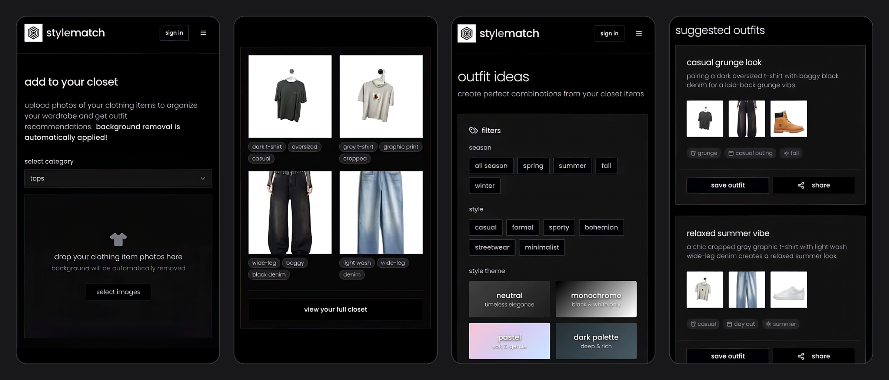

<p align="center">
  
</p>

<h1 align="center">stylematch</h1>

<p align="center"><b>outfits from the clothes you already own</b></p>

StyleMatch is a web app that tags photos of your clothes and of outfits you want to copy, builds outfits out of your own closet, scores how much of a saved look you can already recreate and lists what you would still need to buy to finish it. About 6,000 people used it during the year it was publicly available.



## why i built it

I started building StyleMatch after noticing how hard it sometimes was to pick an outfit and realizing that plenty of other people ran into the same problem. The idea was to let you photograph what you already own and have the app work out what goes together, including how close your closet can get to a look you saved from somewhere else.

## features

- **closet upload:** Several photos can be uploaded at once under a single category (tops, bottoms, outerwear, shoes, accessories, dresses, suits or other). Each photo has its background removed in the browser before upload to give every item the same white background.
- **automatic tagging:** GPT-4o mini labels every item with roughly six to ten short tags describing its type, color, pattern, fit and style (for example "black denim", "wide-leg", "oversized" or "grunge"). Fit and style tags come from a 28-term guide written into the prompt.
- **look matching:** A screenshot of an outfit you like goes through the same tagging step before StyleMatch scores how much of it your closet already covers and shows which of your items match along with the tags you don't own yet.
- **missing pieces:** For anything your closet doesn't cover, the model lists the pieces to buy with a high, medium or low priority, a one-line reason the look needs each one, three to five search terms and the kind of store that usually carries it.
- **outfit ideas:** The outfit page builds up to four outfits from items in your closet and can be filtered by season and by one of eight style themes (chill, old money, streetwear, minimalist, boho, preppy, edgy and romantic).

## how it works

1. **background removal:** The upload page uses [`@imgly/background-removal`](https://github.com/imgly/background-removal-js) to cut each item out of its photo in the browser and flatten it onto a white PNG.
2. **storage:** The server reads the first bytes of every upload to confirm it is a real JPEG, PNG or WebP file before giving it a random UUID name and saving it to a private bucket on Neon Object Storage.
3. **tagging:** The tags OpenAI's vision model returns for each photo in JSON mode are checked against a zod schema before being lowercased, deduplicated and capped at fifteen per item.
4. **look matching:** Tags on an inspiration photo are compared against every tag in the closet using the formula under [matching logic](#matching-logic).
5. **missing pieces:** The inspiration photo and the full list of closet tags are sent to the model together in one request.
6. **outfits:** The closet is filtered for the chosen season and sent to the model with a short list of rules. Every outfit that comes back is checked against the real closet before it appears on the page.

## matching logic

**closet coverage:** A tag from the inspiration photo counts as covered when at least one item in the closet has the exact same tag.

```
score = round(100 × covered tags ÷ inspiration tags)
```

Every closet item that shares a tag with the look is returned as a match. Tags that nothing in the closet covers appear on the page under "not in your closet yet".

**outfit checks:** Because the model doesn't always follow the rules in its prompt, `server/outfits.ts` runs every suggestion through these checks:

| check | rule |
|---|---|
| base | exactly one top and one bottom, or exactly one dress or suit |
| shoes | exactly one pair whenever the closet has shoes |
| items | every id has to exist in this user's closet |
| repeats | no two outfits share the same top and bottom (or dress) |
| season | shorts are removed before the request in fall and winter |
| count | the first four outfits that pass are kept |

The page only shows suggestions that pass every check and asks for different filters when none of them do.

## technical highlights

- **a fixed vocabulary for tags:** Matching works by exact tag overlap and falls apart if the same jeans come back as "baggy" one day and "loose fit" the next. The prompt defines 16 fit terms (balloon pants, tapered, bootcut, mom jeans and so on) and 12 aesthetics (Y2K, normcore, dark academia and others) that the model has to use when they apply.
- **background removal on the user's device:** Cutting clothes out of their photos happens entirely in the browser through a segmentation model that only downloads once someone uploads their first photo. A cutout that fails for any reason falls back to the original photo instead of blocking the upload.
- **cached missing pieces:** Each missing-piece answer is stored on its inspiration photo and reused on every later visit until the owner adds an item to the closet or deletes one.
- **rate limiting:** Each IP address can make up to 60 AI requests and start up to 10 guest sessions per hour.

## tech stack

| layer | technology |
|---|---|
| frontend | React 18, TypeScript, Vite, Tailwind CSS, shadcn/ui, TanStack Query, wouter |
| backend | Node.js, Express, Passport (local strategy), express-session |
| database | PostgreSQL on Neon, Drizzle ORM, connect-pg-simple for sessions |
| image storage | Neon Object Storage through `@aws-sdk/client-s3` |
| ai | OpenAI GPT-4o mini (vision and JSON mode), zod |
| background removal | `@imgly/background-removal` in the browser |

## project structure

```
client/src/
├── pages/            closet, upload, inspiration, matching, missing pieces, outfit ideas, auth
├── components/       header, footer, layout and the shadcn/ui pieces in ui/
├── hooks/            session state and toasts
└── lib/              api client, query client and background removal
server/
├── index.ts          app setup and error handling
├── auth.ts           login, sign-up and sessions
├── storage.ts        database queries
├── images.ts         image storage and file type checks
├── ai.ts             OpenAI calls and response validation
├── prompts.ts        tagging, outfit and missing-piece prompts along with the style guide
├── outfits.ts        outfit checks and closet coverage scoring
└── routes/           closet, inspiration, outfits, images and site settings
shared/
└── schema.ts         database tables and the types shared by client and server
```

The project is about 4,100 lines of TypeScript across 46 files without counting the shadcn/ui components.

## running it yourself

Running it locally takes Node 20.6 or newer, a PostgreSQL database and an OpenAI key for the AI features.

```bash
git clone https://github.com/niranjan-deshpande1/Stylematch.git
cd Stylematch
npm install
cp .env.example .env     # fill in DATABASE_URL at minimum
npm run db:push          # creates the tables
npm run dev              # http://localhost:5000
```

| variable | needed for |
|---|---|
| `DATABASE_URL` | everything |
| `SESSION_SECRET` | production |
| `OPENAI_API_KEY` | tagging, outfits and missing pieces |
| `OPENAI_MODEL` | optional (defaults to `gpt-4o-mini`) |
| `S3_BUCKET`, `S3_ACCESS_KEY_ID`, `S3_SECRET_ACCESS_KEY` | storing photos in a bucket |
| `S3_ENDPOINT`, `S3_REGION`, `S3_FORCE_PATH_STYLE` | Neon Object Storage (`us-east-2` with path-style URLs) |
| `UPLOAD_DIR` | optional folder for photos when no bucket is set (defaults to `./uploads`) |
| `ADMIN_PASSWORD` | optional login for `/admin` |
| `PORT` | optional (defaults to `5000`) |

`npm run build` bundles the client and server into `dist/` for `npm start` to run. Hosts that skip dev dependencies need `npm install --include=dev` before the build.

## privacy

Photos are stored in a private bucket, shown only to whoever uploaded them and never sent anywhere except OpenAI for tagging and missing-piece analysis. The app contains no analytics or ad tracking code and stores passwords only as salted scrypt hashes.

## credits

- [OpenAI](https://openai.com) for the vision model
- [IMG.LY background removal](https://github.com/imgly/background-removal-js)
- [shadcn/ui](https://ui.shadcn.com) components

## license

All rights reserved. No license is granted to use, copy or distribute this code.

## contact

Niranjan Deshpande ([LinkedIn](https://linkedin.com/in/niranjan-deshpande-09ad))
